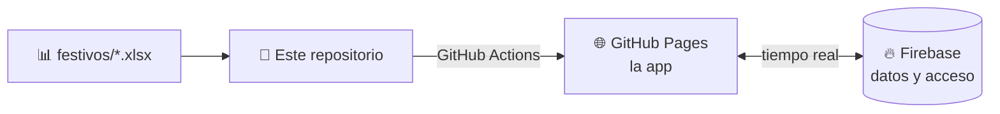

<div align="center">

# 🏖️ Vacaciones del equipo

**Calendario de vacaciones compartido · en tiempo real · en castellano · pensado también para el móvil**

[](https://sdg-group.github.io/Vacaciones-cpc/)


</div>

---

## 🧭 ¿Qué necesitas?

| 🛠️ Montar o mantener la app | 📖 Aprender a usarla | ❓ Resolver dudas |
|:--|:--|:--|
| **[Instalación →](docs/INSTALACION.md)**<br>Firebase, GitHub y datos iniciales | **[Guía de uso →](docs/GUIA-DE-USO.md)**<br>Marcar días, altas y bajas, festivos | **[Preguntas frecuentes →](docs/FAQ.md)**<br>Problemas habituales |

> 💡 La guía también está como [**página web con pestañas**](https://sdg-group.github.io/Vacaciones-cpc/guia.html), dentro de la propia app.

## ✨ Qué hace

- 📅 **Tres vistas** del calendario: tabla por equipos, meses y resumen mensual.
- 🧮 **Saldos automáticos**: 22 días base + extras, pendientes del año anterior con caducidad el 30 de abril y parte proporcional.
- 🎌 **Festivos por ubicación** (Barcelona, Madrid, Valencia…), cargables desde un fichero Excel/CSV.
- 👥 **Solapamientos** dentro de cada equipo y filtros por equipo o persona.
- 📤 **Descarga en Excel** con colores, y copia de resumen.
- 🌗 **Modo claro y oscuro**, y uso desde el móvil.
- 🕘 **Historial** de las vacaciones marcadas.

## 🧱 Cómo está hecha



## 📁 Estructura

```
.
├── src/                  la app (index.html), guía web, conexión con Firebase
├── festivos/             un fichero por año: 2028.xlsx o 2028.csv
├── plantilla/            plantilla de festivos
├── docs/                 instalación, guía de uso y preguntas frecuentes
├── extras/               solo si se pasa a GitLab
├── build.mjs             valida los festivos y prepara la publicación
├── firestore.rules       reglas de seguridad de Firebase
└── .github/workflows/    publicación automática
```

> [!NOTE]
> Los datos de las personas y de las vacaciones están **solo en Firebase**. El repositorio contiene el código y los festivos.
